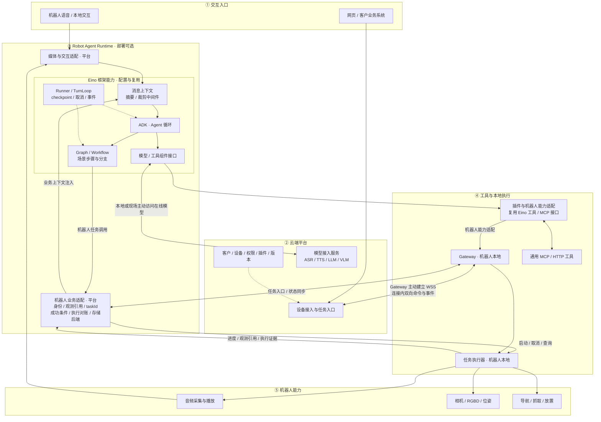

# 机器人 Agent 平台：需求、架构方向与 Eino 选型试用

日期：2026-10-09  
状态：需求与选型讨论记录；已决定优先试用 Eino，尚未完成原型或生产选型。

## 1. 当前结论

产品定位是 **机器人 Agent 平台，也能接通用工具**。平台首先服务机器人交互、观测、任务规划和物理执行，再通过插件扩展搜索、数据库、知识库和客户业务系统。

现有业务功能已经能够满足当前需要。此次工作面向未来的易用性、可维护性和扩展性；业务需求是约束，现有语言、进程划分和云端编排方式均可重新设计。

优先采用 Eino 做 Robot Agent Runtime 原型。依据目前官方文档和源码调研，Eino 提供模型与工具抽象、Agent 循环、图与工作流编排、事件流、取消和中断恢复，可承接 Agent 与编排层的核心职责。该判断是框架能力匹配，不代表整个机器人平台已经实现，也不代表性能和实机可靠性已验证。

当前决策：

- Eino：首个原型候选。
- Mastra：正式对照候选，重点比较语音组合、API 接入和调试体验，详见第 12 节。
- LangChain / LangGraph：保留为对照候选，原型阶段不同时引入第二套编排引擎。
- ZCode：参考其本地 Agent、插件接入和跨平台产品组织方式。
- MCP：通用工具接入和对外开放的协议选项。
- 默认重点验证机器人或现场运行 Agent、共享云端管理和模型服务的方式；最终部署位置由验证结果确定。

## 2. 业务背景与现有架构

根据本次需求讨论，当前业务围绕实时语音交互、导览与导航、相机与 RGBD 观测，以及抓取和放置等高层机器人能力展开。后续还可能从网页输入自然语言任务，接入更多客户、设备、模型和外部模块。

当前总体分工是：机器人上有 Gateway，云端负责会话、模型接入、任务处理和编排，设备侧完成实际观测和执行。Gateway 大概率位于 NAT 后，只能主动连接云端。

当前工程的历史说明见 [工程架构详解](architecture-current-2026-09-20.md) 和 [已知边界](known-gaps.md)。这些文档用于理解业务链路，不作为新架构必须沿用的约束；具体部署与现有实现状态需要另行核对。

## 3. 已明确的需求

| 编号 | 需求 | 验证重点 |
| --- | --- | --- |
| R01 | 产品以机器人 Agent 为核心，也能调用通用工具 | 观测、动作、任务和执行证据有明确契约 |
| R02 | 保留当前业务能力，允许技术实现重构 | 用当前业务场景回归，避免只验证普通聊天 |
| R03 | 支持机器人语音和网页自然语言任务入口 | 两种入口进入统一任务体系，身份和目标设备明确 |
| R04 | 可替换不同厂商的模型 | 切换适配器不需要修改场景规划与执行逻辑 |
| R05 | 支持 ASR、TTS、LLM、VLM 组合，也能接端到端多模态服务 | 模态能力差异显式表达，不强制所有模型实现同一种链路 |
| R06 | 工具和外部模块可按协议接入、替换、增加 | 描述、参数、执行和生命周期均有接口 |
| R07 | 通用工具可使用 MCP / HTTP 等方式接入 | 发现与调用之外，还验证命名、权限、断连和错误映射 |
| R08 | 支持不同场景流程 | Agent 决策与确定步骤能够组合，场景有版本 |
| R09 | Gateway 主动连接云端，设备无需公网入站端口 | 命令和事件沿已建立连接双向传输 |
| R10 | 长耗时动作具有进度、终态、取消和查询能力 | 已受理、已执行、已验证成功分开记录 |
| R11 | 断线、超时和重启后可核对并恢复任务 | 不能把超时解释为未执行，不能盲目重复物理动作 |
| R12 | 实际执行约束和设备控制在本地 | 资源协调、动作有效性和失联策略不依赖云端往返 |
| R13 | 支持多客户、多用户、多机器人 | 身份、工具集合、上下文、任务和事件不会串用 |
| R14 | 明确一个任务的编排负责人 | 多个入口、重连或恢复不会产生两个并行负责人 |
| R15 | 关注网络、性能与终端资源 | 区分在线连接、活跃会话、模型并发和媒体吞吐 |
| R16 | 容易开发、排查、交付和升级 | 有运行记录、版本关联、配置校验与回滚路径 |

语言不是当前选型的首要限制。Go、TypeScript 或其他实现需要按运行部署、开发体验、依赖和维护成本比较；不能仅根据语言推断系统容量。

## 4. 选型思路如何形成

### 4.1 从工具注册和协议扩展出发

最初关注本地能力如何变成模型可调用的工具：schema 的来源、调用路由、同步与异步返回、视觉数据回流，以及多设备身份绑定。

随后明确：支持模型厂商的 tool calling 与支持 MCP 是不同层次的事情。模型协议负责表达调用意图；工具适配负责接入服务；机器人执行协议还要表达任务身份、状态、取消和恢复。

### 4.2 调研 ZCode

ZCode 提供了本地 Agent 配合在线模型的参考。其本地运行时负责组织上下文、驱动模型与工具循环、加载插件和执行本地工具。多用户共享云端模型服务，并不意味着每个用户的 Agent 循环都由中心云端驱动。

这促使我们重新评估：机器人端可以承载 Agent Runtime，云端可以专注统一管理与模型接入。ZCode 的编码工具和产品结构需要按机器人业务重新设计。

### 4.3 调研 LangChain / LangGraph

LangChain 提供模型和工具等组件，LangGraph 提供有状态编排与恢复机制，可作为 Agent Runtime 的实现候选。框架本身不决定 Gateway 的建连方向，也不提供完整的机器人执行契约。

### 4.4 明确可以重构，并确定产品定位

用户明确：当前功能已满足业务，有时间评估重构；优先考虑未来易用性、维护性和扩展性。之后确定产品是机器人 Agent 平台，而非以任意通用 Agent 为中心的平台。

因此，架构设计先明确机器人任务、观测与执行边界，再选择框架。当前代码用于提取业务样本和回归用例。

### 4.5 将 Eino 列为首个试用候选

Eino 同时提供 Go 组件接口、Agent Development Kit 和图/工作流编排，与拟定的 Robot Agent Runtime 职责匹配。用户目前决定基于 Eino 先试用。

这是进入原型阶段的选择；生产定型仍需完成业务、故障恢复、适配和资源验证。

## 5. 目标分层架构

图中展示目标架构草案，默认重点验证机器人或现场运行 Agent。v2 将 Eino 已提供的上下文、编排、模型与工具接口、恢复和事件机制嵌套在框架范围内，区分框架复用与平台业务适配。图片与下方逻辑图互为补充，不表示所有模块已实现或每个框均需独立部署。可编辑版本见 [SVG 架构图](diagrams/robot-agent-eino-architecture-2026-10-09.svg)；修改 [生成脚本](diagrams/generate_robot_agent_eino.py) 可重新生成 SVG，PNG 为浏览器渲染导出。

| 层级 | 职责 | 部署方向 |
| --- | --- | --- |
| L1 交互入口 | 机器人语音、本地操作、网页、客户业务接口 | 本地与云端 |
| L2 云端平台 | 客户与设备管理、权限、配置、插件分发、版本、设备接入、模型接入、运行记录 | 中心云端 |
| L3 Robot Agent Runtime | 复用 Eino 的 Agent 循环、上下文、场景编排、模型工具接口、恢复与事件机制；平台注入机器人任务语义与适配 | 机器人、现场或云端，按配置选择 |
| L4 工具与执行 | 基于 Eino 工具/MCP 接口适配插件与机器人能力；Gateway、任务执行器、资源协调、执行记录与取消 | 工具接入随 Agent；设备网关和执行保留本地 |
| L5 机器人能力 | 音频、相机、RGBD、导航、抓取、放置、驱动与设备控制 | 机器人本地 |

该图表示逻辑职责，并不要求每个框都成为独立进程。上下文处理、消息状态、图状态、取消、恢复和事件机制优先使用 Eino，通过框架中间件与扩展点配置业务行为，不另建一套并行的上下文或编排引擎。平台补充机器人身份、观测时效、动作任务编号、业务成功条件和存储适配；执行器保存实际执行事实。业务记录与框架状态通过编号和版本关联，由同一个任务负责人驱动。

图中的“业务上下文注入”指提供当前设备、地图、目标和观测引用等信息，不是另行实现消息压缩或会话状态引擎。长期业务记忆、持久化后端和数据保存策略仍需配置或接入，不能把框架上下文能力理解为所有数据自动持久化。

### 5.1 部署位置与模型位置分别决定

重点验证三种部署方式：机器人独立运行 Agent、客户现场服务器管理多个机器人、中心云端运行 Agent。第一阶段不实现任务在三处自动迁移。

Agent 在本地运行，可以继续调用云端模型；这不自动获得离线理解和规划能力。完整离线能力还取决于 ASR、LLM/VLM、TTS、插件依赖和模型资源是否在本地可用。

### 5.2 网络与性能边界

- Gateway 出站建连，云端沿已有连接下发命令；不要求云端访问 NAT 后的机器人 HTTP 服务。
- 对外提供机器人 MCP 接口时，可由可达的云端服务代理到设备链路；不能假设 MCP 自动解决 NAT。
- 音频和图像通过媒体模块流式处理，Agent 接收话轮、观测完成、任务事件等语义输入，不对每个媒体包运行图节点。
- 测量队列、带宽、帧大小和事件延迟后，再决定控制与媒体是否需要独立通道。
- 大量设备重连需要退避与抖动；云端多实例还需明确连接归属和内部路由。

## 6. Eino 的适用范围与待补能力

### 6.1 可使用的框架基础

| Eino 能力 | 平台中的用途 |
| --- | --- |
| 模型组件与适配 | 接入 LLM/VLM，统一所支持的输入输出能力 |
| ADK / ChatModelAgent | 驱动模型、工具和上下文循环 |
| 消息状态与 Summarization / Reduction 中间件 | 复用上下文处理机制，配置摘要、工具结果裁剪与保留策略 |
| Graph / Workflow | 表达需要明确步骤与分支的场景流程 |
| 工具接口与 MCP 扩展 | 接机器人能力和外部通用工具 |
| 事件流、Runner、TurnLoop | 接收运行事件，处理话轮和抢占 |
| Interrupt / Resume / CheckPointStore | 在设计的恢复边界保存和继续编排 |
| Callback | 日志、耗时、追踪与运行诊断 |

依据见 [Eino 核心说明](https://github.com/cloudwego/eino)、[ADK 文档](https://www.cloudwego.io/docs/eino/core_modules/eino_adk/agent_preview/) 和 [TurnLoop 与取消文档](https://www.cloudwego.io/docs/eino/core_modules/eino_adk/agent_cancel_and_turnloop_quickstart/)。

上下文机制依据见 [Summarization](https://www.cloudwego.io/docs/eino/core_modules/eino_adk/eino_adk_chatmodelagentmiddleware/middleware_summarization/) 和 [Reduction](https://www.cloudwego.io/docs/eino/core_modules/eino_adk/eino_adk_chatmodelagentmiddleware/middleware_toolreduction/)。框架提供机制；原型需要配置触发阈值、保留内容、模型、存储与机器人业务数据的注入方式。

### 6.2 平台仍需建设的部分

- Gateway 通信、连接生命周期和设备身份。
- 机器人任务契约、执行记录、状态对账和资源占用。
- RGBD 观测引用、时效、坐标系、位姿缓存与结果验证。
- 音频采集播放、VAD、唤醒、打断，以及 ASR/TTS/实时模型适配。
- 客户与设备管理、权限、插件安装分发、配置和升级。
- 工具命名、发现、动态刷新、版本兼容和断连恢复。

上述补充以业务适配、后端接入和设备执行为范围，复用已有 Eino 机制。Agent 循环、上下文摘要/裁剪、通用图调度、checkpoint 和 callback 不作为平台重复建设的独立引擎。

Eino 的工具组件是插件运行的基础，不能据此假设已有完整插件市场、动态安装或统一设备管理。

### 6.3 必须实测的框架边界

1. **取消传播。** Agent cancel 需要映射到停止播音、停止旧模型输出、取消执行任务，并取得本地终态。软件取消完成与机械臂或导航停止分开确认。
2. **恢复与副作用。** 框架 checkpoint 不能保证物理动作恰好执行一次。收到重复命令、工具重跑或结果丢失时，需要基于执行记录对账。
3. **持久化与升级。** CheckPointStore 需要接入持久化实现。官方说明图恢复要求编排一致，需为运行中的任务绑定流程和运行时版本。[checkpoint 文档](https://www.cloudwego.io/docs/eino/core_modules/chain_and_graph_orchestration/checkpoint_interrupt/)
4. **多模态映射。** schema 能表达图片或音频，不等于所有模型适配器都支持同一模态或实时协议。逐项验证目标厂商。
5. **MCP 图像结果。** 调研到的 MCP 适配器将 CallToolResult 序列化成字符串；需要验证视觉内容如何转换为模型可理解的图像输入。[适配器源码](https://github.com/cloudwego/eino-ext/blob/main/components/tool/mcp/mcp.go)
6. **并发隔离。** 每个客户、设备和会话的工具集合、模型配置、上下文、任务与事件必须隔离；不能共享可变状态而发生覆盖。

## 7. 机器人平台的核心契约

以下是原型需要验证的语义范围，尚未冻结为最终字段或协议。

| 契约 | 必须表达的内容 |
| --- | --- |
| 模型 | 输入输出模态、流式能力、工具调用能力、取消、错误与厂商扩展 |
| 观测 | 编号、采集时间、来源设备、坐标系、有效期、数据引用及所关联任务 |
| 工具 | 命名空间、版本、描述、参数、权限、执行方式、取消与结果语义 |
| 任务 | 客户、设备、目标、负责人、任务编号、流程版本、状态与恢复边界 |
| 执行 | 命令编号、幂等标识、资源占用、前置条件、实际状态和终态证据 |
| 插件 | 提供的模型或工具能力、依赖、配置、部署位置、兼容版本与生命周期 |
| 事件 | 关联编号、顺序或去重标识、发生时间、类型、载荷与版本 |

必须区分以下含义：

- 请求已收到。
- 任务已被接受。
- 动作开始执行。
- 动作执行结束。
- 业务目标经过证据验证完成。
- 由于失联或信息缺失，当前结果未知。

搜索等工具与物理动作采用各自的重试策略。同一个执行编号的重复请求需要去重；模型再次生成相似意图则还需任务负责人判断是否属于新任务，不能仅依赖编号去重。

## 8. 如何开展 Eino 原型

### 阶段 A：确定验证环境与基线

记录机器人/现场硬件、操作系统、CPU 架构、可用内存、GPU、网络条件、模型版本、业务样本与现有链路耗时。确定必测部署方式和业务成功标准。

第一阶段不承诺完整离线、多机器人协作或插件市场。是否进入后续范围，按业务要求与验证结果决定。

### 阶段 B：跑通最小 Agent 与工具链

建立可独立运行的 Eino 原型，使用一个真实模型适配器、模拟执行器与一个通用工具。验证自然语言输入、工具调用、结构化结果、任务编号和事件关联。

试用时固定 Eino 稳定发布与扩展模块版本，记录 Go 工具链和目标平台；不使用浮动 main 作为可重复验证的基准。

### 阶段 C：验证观测抓取与异步任务

使用固定 RGBD 样本或可控观测服务，完成：目标输入 → 观测 → 模型选择 → 提交动作 → 执行事件 → 结果验证。

长动作的提交和终态等待分开处理。恢复前先查询执行记录，不能把一个真实动作简单包装成可自动重试的普通函数。

### 阶段 D：验证语音、替换能力与故障恢复

接入 ASR/LLM/TTS 或实时多模态路径，验证打断。增加第二个模型适配器与外部 MCP 工具。注入断网、重复事件、模型超时和进程重启。

先完成模拟验证，再在符合本地执行约束的条件下验证真实设备。

### 阶段 E：决定是否采用

根据下表记录证据、问题和维护成本。若 Eino 满足要求，确定职责划分和版本策略，再编写正式实施计划。若某个关键机制不适配，针对该场景与 LangGraph 对照，避免同时维持两套任务状态和编排负责人。

新增 Mastra 后，也按同一套业务用例开展对照；不在一个任务中叠加 Eino 与 Mastra 两套编排引擎。

## 9. 原型验收与选型证据

| 用例 | 对应需求 | 通过条件 | 当前状态 |
| --- | --- | --- | --- |
| 网页提交机器人任务 | R03、R09、R13 | 鉴权后路由到正确设备，Gateway 无需入站端口 | 未执行 |
| 语音交互与打断 | R03、R05、R10 | 旧播音/输出被正确终止，新话轮不混入旧结果 | 未执行 |
| RGBD 观测抓取 | R01、R02、R10、R12 | 引用有效观测，实际执行与业务验证可追溯 | 未执行 |
| 确定流程与 Agent 组合 | R08 | 规定步骤与开放决策各有边界，流程有版本 | 未执行 |
| 替换模型厂商 | R04、R05 | 通过适配器替换，场景与执行逻辑无需修改 | 未执行 |
| 接入 MCP 工具 | R06、R07 | 发现、调用、鉴权、错误与断连得到正确处理 | 未执行 |
| 工具返回图像 | R05、R06 | 目标模型确实收到可理解的视觉输入 | 未执行 |
| 长动作异步执行 | R10 | 受理、进度和终态关联；可查询和取消 | 未执行 |
| 动作后结果丢失 | R11、R12 | 对账后恢复，不重复物理动作 | 未执行 |
| Agent / 执行器重启 | R11、R14、R16 | 从持久记录恢复；未知状态明确阻止冲突动作 | 未执行 |
| 两个客户与两台设备 | R13、R14 | 工具、上下文、事件与任务无交叉，资源冲突明确处理 | 未执行 |
| NAT、弱网与重连 | R09、R11、R15 | 主动重连、能力重新声明、任务对账和事件关联正确 | 未执行 |
| 并发与资源测量 | R15 | 记录连接数、活跃会话、吞吐、队列、CPU、内存及延迟 | 未执行 |
| 版本升级与回滚 | R08、R16 | 新旧流程状态可正确处理，不能加载不兼容状态继续动作 | 未执行 |

性能记录至少包含首文本、首音频、命令受理、取消生效、执行事件回传的 p50/p95，以及媒体吞吐、队列积压和单实例资源。区分模型推理耗时、网络耗时、框架开销和设备执行耗时。

具体数值门槛在阶段 A 根据业务体验与目标硬件确定，不能以未经测量的数字作为选型结论。

生产采用前应具备：完整关键业务链路、取消与恢复证据、租户和设备隔离证据、可重复的资源测量、明确的升级策略。单次工具调用成功不足以证明平台适用。

## 10. 仍需确认的产品参数

- 首批机器人的硬件、操作系统和 CPU 架构；Agent 能使用多少 CPU、内存和 GPU。
- 第一部署目标是机器人本地，还是客户现场服务器。
- 断网期间仅保持已有任务执行，还是必须接受并理解新的自然语言任务。
- 预计在线设备、同时活跃会话、同时动作任务，以及媒体采样和上传策略。
- 优先接入的模型厂商与具体模态；实时语音与分离式 ASR/LLM/TTS 的优先级。
- 第一批必须支持的客户场景和通用插件。
- 客户是否要求观测数据留在现场，以及运行记录的保存范围。

这些参数影响部署和验收标准，不改变优先开展 Eino 原型的当前决策。

## 11. 调研依据与状态

本次 Eino 调研采用官方文档、核心源码与扩展适配器源码，未运行 Eino 示例或机器人动作，也未完成性能测试。

- 最新发布核对：[Eino v0.9.21](https://github.com/cloudwego/eino/releases/tag/v0.9.21)。
- 核心源码阅读快照：[`58d184303f4e73413c454a9626f79c17af0fd9fb`](https://github.com/cloudwego/eino/tree/58d184303f4e73413c454a9626f79c17af0fd9fb)，main 提交日期 2026-09-29；不等同于原型已使用此版本。
- [Eino 模型接口](https://github.com/cloudwego/eino/blob/58d184303f4e73413c454a9626f79c17af0fd9fb/components/model/interface.go)、[工具接口](https://github.com/cloudwego/eino/blob/58d184303f4e73413c454a9626f79c17af0fd9fb/components/tool/interface.go)、[Runner](https://github.com/cloudwego/eino/blob/58d184303f4e73413c454a9626f79c17af0fd9fb/adk/runner.go)。
- [Eino 扩展库](https://github.com/cloudwego/eino-ext)。MCP 适配器按调研时 main 查看，实际使用需要固定模块版本并复核行为。
- [LangGraph 定位](https://docs.langchain.com/oss/javascript/langgraph/overview)、[持久化说明](https://docs.langchain.com/oss/javascript/langgraph/persistence)。
- [ZCode 源码调研快照](https://github.com/zai-org/ZCode/tree/29628c9acdb81b703bbd4080c207a0e7ce5e276e)、[Agent 任务循环](https://github.com/zai-org/ZCode/blob/29628c9acdb81b703bbd4080c207a0e7ce5e276e/apps/zcode-cli/packages/core/src/runtime/methods/turn-loop.ts)。
- [MCP 传输规范](https://modelcontextprotocol.io/specification/2026-07-28/basic/transports)。实际接入按选用 SDK 的协议版本核对兼容性。

后续更新应记录原型的实际依赖版本、部署位置、输入样本、结果证据与未解决问题；不要把调研判断直接改写为实测结论。

## 12. Mastra 补充调研与对照方向

调研日期：2026-10-09。依据官方文档、仓库说明、包元数据与 npm 发布元数据；尚未安装、运行或开展性能测试。当前仍优先试用 Eino，Mastra 列为正式对照候选。

### 12.1 为什么值得对照

[Mastra](https://github.com/mastra-ai/mastra) 是 TypeScript Agent 应用框架，提供 Agent、工作流、记忆、存储、模型接入、MCP、HTTP 服务、Studio 与可观测性等组件。它与我们关注的应用开发、调试和交付体验直接相关。

| 已核对的能力 | 与机器人平台的关系 | 官方依据 |
| --- | --- | --- |
| Agent 与确定工作流 | 可承接 L3 的任务理解和场景编排 | [工作流](https://mastra.ai/docs/workflows/overview) |
| Voice / CompositeVoice | 可以组合不同的 STT/ASR、TTS 服务，也有实时语音提供者；具体能力由提供者决定 | [Voice](https://mastra.ai/reference/voice/overview)、[CompositeVoice](https://mastra.ai/reference/voice/composite-voice) |
| MCPClient / MCPServer | 接入外部工具，并向外暴露 Agent、工具和工作流 | [MCP](https://mastra.ai/docs/connections/mcp) |
| suspend / resume / snapshots | 挂起等待外部结果，再从已保存状态恢复；需要配置持久化存储 | [暂停恢复](https://mastra.ai/docs/workflows/suspend-and-resume)、[快照](https://mastra.ai/docs/workflows/snapshots) |
| HTTP 服务、客户端与请求上下文 | 对接网页和业务系统，向工具传递请求级身份与配置 | [Server](https://mastra.ai/docs/server/overview) |
| Studio | 调试 Agent、工具与流程，查看运行状态和追踪 | [Studio](https://mastra.ai/docs/studio/overview) |

部署需要 Node.js 兼容环境，可以位于云端、客户现场或机器人上。TypeScript 与 Web 开发生态的结合，不限制它只能云端运行，也不能据此推断其容量低于 Go。

### 12.2 与 Eino 的比较重点

| 比较维度 | Eino 路线 | Mastra 路线 |
| --- | --- | --- |
| 运行环境 | Go 运行服务；核对目标架构、依赖和交付方式 | Node.js 运行服务；核对版本、依赖和终端资源 |
| 编排核心 | ADK Agent 循环与 Graph / Workflow | Agent 与 Workflows |
| 交互与模型组合 | 重点验证自有媒体链路与模型适配如何接入 | 重点验证 Voice 抽象、CompositeVoice 和实时语音适配 |
| 开发与排查 | 评估 callback、日志、运行记录与调试工具的实际使用成本 | 评估 Studio、API、追踪和存储组件的实际使用成本 |
| 工具与插件 | 工具接口与 MCP 扩展，加上平台自己的插件生命周期 | 工具与 MCP 客户端/服务端，加上平台自己的插件生命周期 |
| 物理执行可靠性 | 需要任务编号、执行记录、取消确认和对账 | 同样需要任务编号、执行记录、取消确认和对账 |

这些是验证方向，不是性能排名或实测评分。两个框架都不能代替 Gateway、机器人动作约束、设备管理或完整的客户业务平台。

### 12.3 对机器人业务尤其需要验证的点

1. 分离式 ASR/LLM/TTS 和实时语音模型的工具调用，均经过统一的机器人任务适配，不能绕过身份、资源和执行约束。
2. Voice 的流式输入不自动代表完整的语音打断链路；需要验证采集、播音缓冲、模型取消、新旧话轮及动作取消的协同。
3. 用独立提交步骤创建动作，以任务编号挂起等待结果。恢复时结合执行记录对账；框架 resume 不保证物理动作不会重做。
4. Mastra 支持工作流和步骤重试。物理动作需要明确自己的重试规则，不能直接继承通用工作流重试。[重试文档](https://mastra.ai/docs/workflows/error-handling)
5. 通过 NAT 下 Gateway 主动建立的连接投递命令和接收事件。HTTP API 或 MCP 接口不会自动使机器人可被云端入站访问。
6. 以相同模型、输入样本、硬件、网络与模拟/实机执行器比较实现工作量、延迟、资源占用、恢复行为和部署维护。

### 12.4 版本与组件范围记录

本次 npm `latest` 元数据核对：`@mastra/core` 为 `1.75.0`，`@mastra/mcp` 为 `2.2.0`，CLI `mastra` 为 `1.33.0`，`@mastra/voice-openai-realtime` 为 `0.14.3`；相关包声明 Node.js `>=22.13.0`。这些是调研快照，不是已安装的项目依赖。

同时查看到仓库 main 的 core 元数据含 `1.76.0-alpha.3`，因此不能将 main 与稳定发布混用；原型需要固定各模块的兼容版本，并核对文档对应的 API。

仓库多数代码采用 Apache-2.0，`ee/` 目录采用单独企业许可证。评估具体管理和认证功能时，记录所依赖的组件及许可范围。[许可映射](https://github.com/mastra-ai/mastra/blob/main/LICENSE.md)

当前判断：Eino 与 Mastra 均具备承接 Agent 与编排层的理论基础。优先 Eino 原型，同时把 Mastra 的语音与应用开发体验作为正式比较项；最终选择由同一组机器人业务证据决定。
